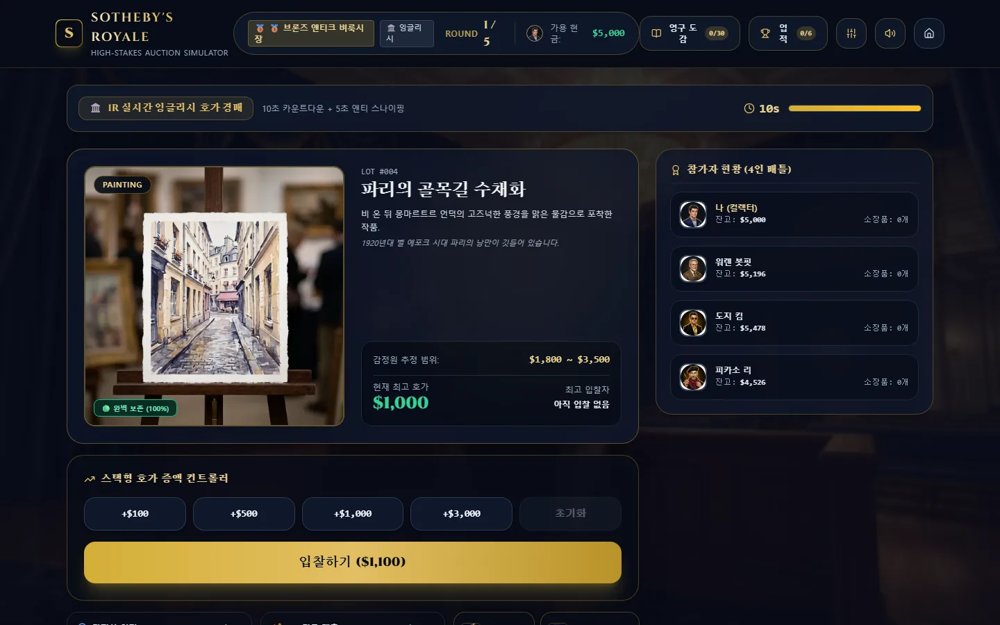
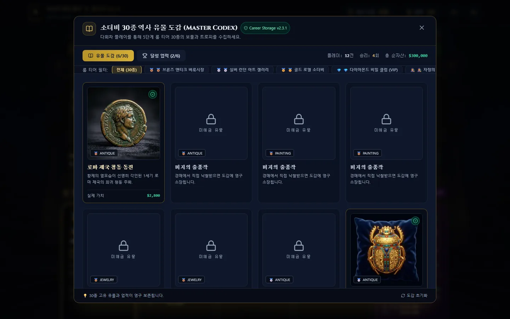

# Simple Auction Game

`Simple Auction Game`은 싱글플레이 경매 경제 시뮬레이션 웹 게임입니다. 플레이어는 AI 경매 참가자들과 5라운드 경매를 진행하고, 유물의 감정·복원·위탁 판매와 영구 커리어를 관리합니다.

## 플레이

[https://simple-auction-game.vercel.app/](https://simple-auction-game.vercel.app/)

> 사이트가 열리지 않는다면 저장소 소유자가 Vercel 프로젝트를 일시 중지하거나 종료했을 수 있습니다.

## 게임 화면

| 로비 | 경매 |
| :---: | :---: |
|  |  |

## 게임 소개

- 잉글리시 호가, 4라운드 비밀 봉투, 더치 역경매를 조합한 5라운드 진행
- 브론즈·실버·골드·다이아몬드·암시장 5개 룸과 순자산 기반 게이팅
- 일반 24종, 암시장 밀수품 6종으로 구성된 30종 유물
- 감정, 복원, 위탁 판매, 도감, 업적, 파산·복구
- 암시장 저주와 경찰 급습
- 브라우저 LocalStorage 기반 커리어 저장

## 기술 스택

- React 18, TypeScript, Vite
- Zustand, Tailwind CSS
- Vitest, Playwright
- Web Audio API
- 브라우저 LocalStorage, 별도 백엔드 없음

## 현재 상태

- 싱글플레이 경매 게임으로 플레이 가능한 상태
- Vitest 22개 파일 / 146개 테스트, Playwright E2E 19개
- typecheck 0오류, production build 통과, 의존성 보안 감사 0건
- 향후 개선과 확장은 별도 계획으로 진행합니다.

## 문서

- 개발·실행·검증·배포: [`DEVELOPMENT.md`](./DEVELOPMENT.md)
- 현재 상태와 검증 증거: [`.md/specs/PROJECT_STATE.md`](./.md/specs/PROJECT_STATE.md)
- 기능 명세: [`.md/root/FEATURES.md`](./.md/root/FEATURES.md)
- 제품 요구사항: [`.md/specs/PRD.md`](./.md/specs/PRD.md)
- 시스템 아키텍처: [`.md/specs/ARCHITECTURE.md`](./.md/specs/ARCHITECTURE.md)
- 데이터 스키마: [`.md/specs/DATA_SCHEMA.md`](./.md/specs/DATA_SCHEMA.md)
- QA 계획: [`.md/specs/QA_TEST_PLAN.md`](./.md/specs/QA_TEST_PLAN.md)
- QA 추적성: [`.md/specs/QA_TRACEABILITY.md`](./.md/specs/QA_TRACEABILITY.md)
- 결정 로그: [`.md/specs/DECISIONS.md`](./.md/specs/DECISIONS.md)
- 작업 보드: [`.md/root/TASKS.md`](./.md/root/TASKS.md)
- 에이전트 운영 규칙: [`.md/root/AGENTS.md`](./.md/root/AGENTS.md)

## 라이선스

이 프로젝트는 개인 취미 프로젝트입니다. 소스와 에셋은 자유롭게 사용할 수 있으며, 사용으로 인해 발생하는 문제에 대해서는 책임지지 않습니다.
