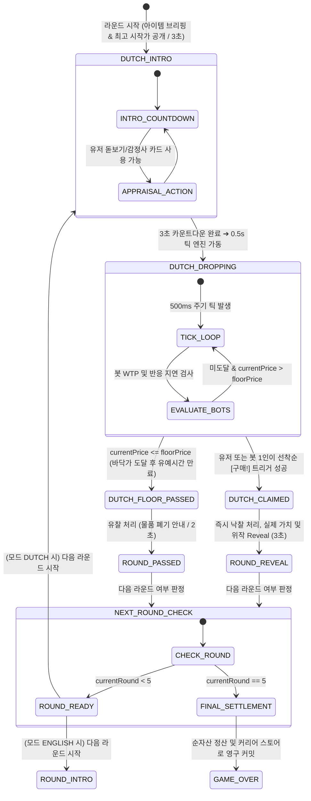
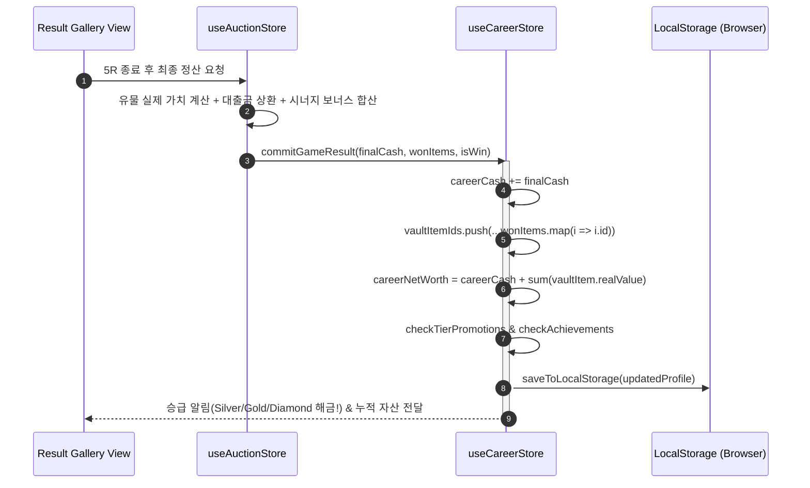
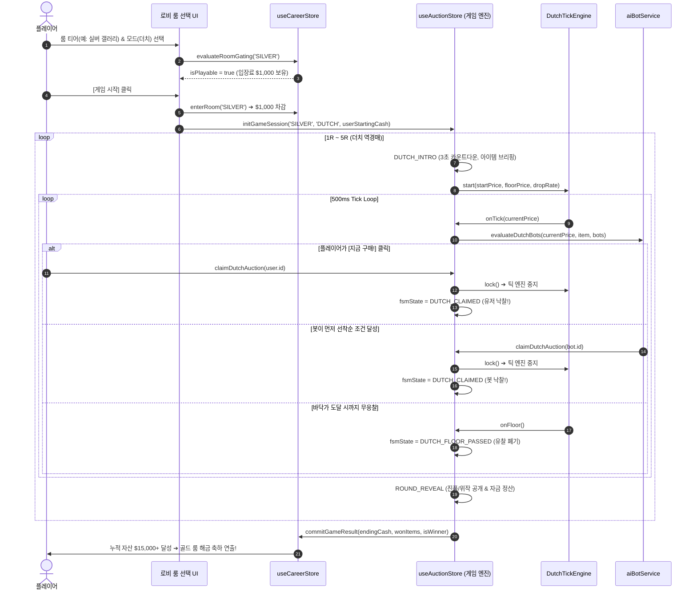

# 🏛 시스템 아키텍처 설계 가이드라인 (Architecture Guideline)

> **문서 버전:** v2.0.0 (Phase 2 Major Architecture Specification)  
> **상태:** HISTORICAL_BASELINE / v2.3 재조정 필요  
> **소유 역할:** ARCH_DATA  
> **분류:** `arch` (시스템 상세 설계서)  
> **작성자:** Lead Architect  
> **참조 문서:** [`docs/common/PRD.md`](../common/PRD.md), [`docs/db/DATA_SCHEMA.md`](../db/DATA_SCHEMA.md), [`docs/common/TASKS.md`](../common/TASKS.md)  
> **최종 상태 검토일:** 2026-08-21  

---

> [!IMPORTANT]
> `STAB-001`의 [ARCH_DATA 상세 계약](../tasks/active/STAB-001.md#7-arch_data-상세-계약)이 v2.3.1 안정화 범위의 최신 권위다. 아래 과거 ARCH-201/202에 남은 `realValue` 기반 더치 WTP, 검증 전 락, `careerCash += finalCash`, 4단계 룸, 전체 24종 표현은 현재 계약으로 사용하지 않는다.

> [!CAUTION]
> 이 문서는 Phase 2의 4개 룸·24종 기준 설계가 포함된 과거 기준선이다. 현재 제품은 암시장을 포함한 5개 룸·30종이며, `DEC-001`~`DEC-004`와 `STAB-001`이 완료되기 전에는 본문의 코드 예시와 “즉시 구현” 문구를 최신 승인 계약으로 사용하지 않는다. 최신 제품 요구사항은 `PRD.md`, 현재 판정은 `PROJECT_STATE.md`를 따른다.

## 📌 목차 (Table of Contents)
1. [ARCH-201: 더치 역경매(Dutch Auction) FSM 및 실시간 틱 엔진 설계](#1-arch-201-더치-역경매dutch-auction-fsm-및-실시간-틱-엔진-설계)
   - 1.1 FSM 상태 머신 및 다이어그램
   - 1.2 상태 전이표 (State Transition Table)
   - 1.3 실시간 틱 엔진 (Tick Engine) 및 동기화 아키텍처
   - 1.4 원자적 선착순 낙찰 (Atomic Claim Lock & Race Condition 방지)
   - 1.5 더치 AI 봇 지불 의사(WTP) 및 인간형 반응 지연 모델
   - 1.6 바닥가(Floor Price) 유찰 처리 및 시퀀스
2. [ARCH-202: 영구 커리어 자산 및 4단계 룸 게이팅 아키텍처 설계](#2-arch-202-영구-커리어-자산-및-4단계-룸-게이팅-아키텍처-설계)
   - 2.1 영구 커리어 자산 모델 (`PersistentCareerProfile`)
   - 2.2 LocalStorage 영구화, 정규화(Normalized) 및 마이그레이션 전략
   - 2.3 4단계 룸 티어 게이팅 엔진
   - 2.4 24종 고유 유물 분할 (Zero Duplication) 풀 생성기
   - 2.5 룸 티어 기반 봇 자금력/지능 동적 팩토리 (기존 난이도 완전 제거)
   - 2.6 인게임 정산 및 커리어 자산 반영 라이프사이클 (`commitGameResult`)
   - 2.7 Zustand 스토어 상호작용 인터페이스 (`useCareerStore` ↔ `useAuctionStore`)
3. [전체 시스템 시퀀스 다이어그램 (End-to-End Game Flow)](#3-전체-시스템-시퀀스-다이어그램-end-to-end-game-flow)

---

# 1. ARCH-201: 더치 역경매(Dutch Auction) FSM 및 실시간 틱 엔진 설계

더치 역경매는 경매 물품의 최고 시작가(`dutchStartPrice`)에서 시작하여 일정 시간(0.5초)마다 가격이 계단식으로 하락하며, **가장 먼저 [지금 구매!]를 선착순으로 트리거한 1인이 즉시 낙찰**받는 내림 입찰 메커니즘입니다.

---

### 1.1 FSM 상태 머신 및 다이어그램



---

### 1.2 상태 전이표 (State Transition Table)

| 현재 상태 (`from`) | 트리거 이벤트 (`event`) | 조건 / 가드 (`guard`) | 다음 상태 (`to`) | 실행 액션 (`action`) |
| :--- | :--- | :--- | :--- | :--- |
| `IDLE` | `START_GAME` | 룸 입장료 지불 완료 | `DUTCH_INTRO` (또는 `ROUND_INTRO`) | 룸 유물 풀 셔플(5종 선정), 플레이어/봇 자금 초기화 |
| `DUTCH_INTRO` | `INTRO_TIMER_END` | 3초 경과 | `DUTCH_DROPPING` | 틱 엔진 시작(`currentPrice = dutchStartPrice`), 봇 의사결정 활성화 |
| `DUTCH_DROPPING` | `PRICE_TICK` | `currentPrice > floorPrice` | `DUTCH_DROPPING` | `currentPrice -= dropAmountPerTick`, 틱 사운드 재생, 봇 WTP 체크 |
| `DUTCH_DROPPING` | `CLAIM_AUCTION` | 선착순 1인 락 획득 & 가용 현금 $\ge$ `currentPrice` | `DUTCH_CLAIMED` | 틱 엔진 즉시 중지, 낙찰자 확정, 낙찰가 현금 차감 및 인벤토리 추가 |
| `DUTCH_DROPPING` | `FLOOR_PRICE_REACHED` | `currentPrice <= floorPrice` & 유예시간(1.0s) 종료 | `DUTCH_FLOOR_PASSED` | 틱 엔진 즉시 중지, 유찰 확정 (`unsold`), 유찰 효과음 재생 |
| `DUTCH_CLAIMED` | `REVEAL_TIMER_END` | 3초 경과 & `round < 5` | `DUTCH_INTRO` | 다음 라운드 인덱스 증가, 신규 아이템 세팅 |
| `DUTCH_CLAIMED` | `REVEAL_TIMER_END` | 3초 경과 & `round === 5` | `FINAL_SETTLEMENT` | 5R 종료, 시너지 및 최종 순자산 계산 후 커리어 스토어에 영구 커밋 |
| `DUTCH_FLOOR_PASSED` | `PASS_TIMER_END` | 2초 경과 & `round < 5` | `DUTCH_INTRO` | 다음 라운드 인덱스 증가, 신규 아이템 세팅 |
| `DUTCH_FLOOR_PASSED` | `PASS_TIMER_END` | 2초 경과 & `round === 5` | `FINAL_SETTLEMENT` | 5R 종료, 최종 정산 및 영구 커밋 |

---

### 1.3 실시간 틱 엔진 (Tick Engine) 및 동기화 아키텍처

1. **틱 주기 및 하락 공식:**
   - **기본 틱 주기:** $T_{\text{tick}} = 500\text{ms}$ (초당 2회 하락)
   - **틱당 감산액:** 
     $$\Delta P_{\text{tick}} = \text{item.dutchDropRatePerSec} \times 0.5$$
   - **가격 클램핑(Clamping):**
     $$P_{\text{next}} = \max(P_{\text{current}} - \Delta P_{\text{tick}},\, \text{item.dutchFloorPrice})$$
2. **타이머 드리프트 방지 (Timestamp Delta Compensation):**
   - 브라우저 탭 비활성화나 렌더링 지연 시 `setInterval` 드리프트가 발생하는 문제를 방지하기 위해 **경과 시간(Elapsed Time) 기반 보정**을 적용합니다.
   ```typescript
   export class DutchTickEngine {
     private intervalId: number | null = null;
     private lastTickTimestamp: number = 0;
     private isLocked: boolean = false;

     start(
       startPrice: number, 
       floorPrice: number, 
       dropRatePerSec: number, 
       onTick: (price: number) => void,
       onFloor: () => void
     ) {
       this.stop();
       this.isLocked = false;
       let currentPrice = startPrice;
       this.lastTickTimestamp = performance.now();

       this.intervalId = window.setInterval(() => {
         if (this.isLocked) return;

         const now = performance.now();
         const elapsedSec = (now - this.lastTickTimestamp) / 1000;
         this.lastTickTimestamp = now;

         const dropAmount = Math.round(dropRatePerSec * elapsedSec);
         currentPrice = Math.max(floorPrice, currentPrice - dropAmount);
         
         onTick(currentPrice);

         if (currentPrice <= floorPrice) {
           this.stop();
           onFloor();
         }
       }, 500);
     }

     stop() {
       if (this.intervalId !== null) {
         clearInterval(this.intervalId);
         this.intervalId = null;
       }
     }

     lock(): boolean {
       if (this.isLocked) return false;
       this.isLocked = true;
       this.stop();
       return true;
     }
   }
   ```

---

### 1.4 원자적 선착순 낙찰 (Atomic Claim Lock & Race Condition 방지)

더치 역경매의 핵심은 **유저의 클릭과 복수 봇의 구매 결정이 동일한 틱 혹은 수 밀리초 내에 경합할 때의 원자성(Atomicity)** 보장입니다.

1. **Claim Mutex Flag:** 
   - `claimAuction(buyerId, price)` 진입 시 `claimMutex` 플래그를 검사합니다.
   - 이미 락이 획득된 상태(`isClaimed === true`)에서의 후속 호출은 즉시 무시(`Reject`)됩니다.
2. **원자적 클레임 처리 플로우:**
   ```typescript
   const claimAuction = (buyerId: string, currentPrice: number): boolean => {
     const { dutchState, tickEngine, players } = get();
     
     // 1. 이미 낙찰 처리되었거나 바닥가 유찰 상태이면 차단
     if (dutchState.isClaimed || !tickEngine.lock()) {
       return false;
     }

     const buyer = players.find(p => p.id === buyerId);
     if (!buyer || buyer.cash < currentPrice) {
       // 잔액 부족 시 낙찰 실패 및 틱 엔진 재개 (유저 실수 방지)
       return false;
     }

     // 2. 단일 승자 확정 및 즉시 상태 전이
     set({
       dutchState: {
         ...dutchState,
         isClaimed: true,
         claimedByPlayerId: buyerId,
         claimedPrice: currentPrice,
       },
       fsmState: 'DUTCH_CLAIMED'
     });

     // 3. 자금 차감 및 아이템 지급
     executeDutchWin(buyerId, currentPrice);
     return true;
   };
   ```

---

### 1.5 더치 AI 봇 지불 의사(WTP) 및 인간형 반응 지연 모델

더치 역경매에서 AI 봇은 매 틱마다 가격을 평가하여, **자신의 지불 의사 가격(WTP, Willingness to Pay) 이하로 가격이 떨어졌을 때** 구매를 시도합니다.

#### A. 봇 WTP(Willingness to Pay) 계산 공식
봇의 WTP는 **(1) 추정 실제 가치, (2) 봇 페르소나 마진율, (3) 룸 티어 공격성, (4) 카테고리 선호도, (5) 보유 현금**의 함수로 산출됩니다.

$$\text{EstimatedValue}_{\text{bot}} = \text{item.realValue} \times (1 + \epsilon_{\text{bot}})$$
- $\epsilon_{\text{bot}}$ : 봇의 감정 오차율 ($\pm 5\% \sim 15\%$, 상위 티어 룸일수록 오차율이 0%에 수렴).

$$\text{TargetMargin}_{\text{persona}} = \begin{cases} 
0.65 \sim 0.75 & (\text{WARREN: 가치투자형 - 감정가 대비 최소 25~35\% 할인 시에만 매수}) \\
0.90 \sim 1.10 & (\text{DOGE: 고점 충동형 - 비싸더라도 매물 선점에 집중}) \\
0.80 \sim 0.85 & (\text{PICASSO: 기본}) \;\; (\text{단, 선호 카테고리 일치 시 } 0.95 \sim 1.05)
\end{cases}$$

$$\text{RawWTP} = \text{EstimatedValue}_{\text{bot}} \times \text{TargetMargin}_{\text{persona}} \times \text{roomConfig.botAggressiveness}$$
$$\text{FinalWTP}_{\text{bot}} = \min(\text{RawWTP},\, \text{bot.cash})$$

#### B. 인간형 반응 지연 (Reaction Latency Jitter)
`currentPrice <= FinalWTP`가 충족된 순간, 즉시 0ms만에 누르면 유저가 절대로 이길 수 없으므로, **인간의 인지/반응 속도를 모사한 지연 타이머($200\text{ms} \sim 800\text{ms}$)**를 스케줄링합니다.

```typescript
export const evaluateDutchBots = (
  currentPrice: number,
  item: Item,
  bots: Player[],
  tierConfig: RoomTierConfig,
  onBotClaim: (botId: string, price: number) => void
) => {
  for (const bot of bots) {
    const wtp = calculateBotWTP(bot, item, tierConfig);
    
    if (currentPrice <= wtp && bot.cash >= currentPrice) {
      // 200ms ~ 700ms 사이의 랜덤 반응 지연 후 claim 시도
      const latencyMs = Math.floor(Math.random() * 500) + 200;
      
      window.setTimeout(() => {
        // 지연 시간 후 여전히 경매가 진행 중이고 가격 조건을 만족하면 시도
        onBotClaim(bot.id, currentPrice);
      }, latencyMs);
      
      break; // 라운드당 최초 충족 봇 1개만 우선 예약
    }
  }
};
```

---

### 1.6 바닥가(Floor Price) 유찰 처리 및 시퀀스

1. `currentPrice`가 `item.dutchFloorPrice`에 도달하면 틱 감산을 멈추고 1.0초간의 최종 기회(Final Window)를 부여합니다.
2. 유예 시간 동안 아무도 `CLAIM`하지 않으면 `fsmState = 'DUTCH_FLOOR_PASSED'`로 전환됩니다.
3. 물품은 유찰 폐기 처리되며, 2초 후 `NEXT_ROUND_CHECK`로 진행됩니다.

---

# 2. ARCH-202: 영구 커리어 자산 및 4단계 룸 게이팅 아키텍처 설계

인위적인 Easy/Normal/Hard 난이도를 전면 폐지하고, 유저의 순자산(Net Worth) 성장에 따라 상위 룸이 해금되는 **영구 커리어 자산 경제(Persistent Career Economy)**를 구축합니다.

---

### 2.1 영구 커리어 자산 모델 (`PersistentCareerProfile`)

```typescript
export interface PersistentCareerProfile {
  storageVersion: '2.0.0';     // 스토리지 마이그레이션 버전 키
  careerCash: number;          // 현재 보유 가용 현금 ($) (신규 유저: $5,000)
  careerNetWorth: number;      // 총 순자산 (가용 현금 + 보관함 유물 실제 가치 총합)
  vaultItemIds: string[];      // 획득하여 영구 보관 중인 24종 유물 고유 ID 목록
  unlockedAchievementIds: string[]; // 달성 완료된 업적 ID 목록
  highestRoomTierUnlocked: RoomTier; // 현재까지 해금된 최고 룸 티어
  totalGamesPlayed: number;    // 누적 플레이 판 수
  totalWins: number;           // 1위 달성 횟수
  lastUpdatedTimestamp: number;
}
```

---

### 2.2 LocalStorage 영구화, 정규화(Normalized) 및 마이그레이션 전략

1. **정규화 저장 원칙 (Normalized Storage):**
   - 아이템의 전체 객체를 스토리지에 통째로 저장하지 않고, **ID 목록(`vaultItemIds: string[]`)**만 저장합니다.
   - 런타임 하이드레이션 시 `MASTER_ITEMS_V2` 마스터 테이블과 `join`하여 최신 에셋 URL 및 밸런스 데이터를 주입함으로써 **Stale Cache 오염을 원천 차단**합니다.
2. **자동 마이그레이션 및 Fallback 복구 플로우:**
   ```typescript
   export const STORAGE_KEY_V2 = 'SIMPLE_AUCTION_CAREER_V2';
   export const INITIAL_CAREER_PROFILE: PersistentCareerProfile = {
     storageVersion: '2.0.0',
     careerCash: 5000,
     careerNetWorth: 5000,
     vaultItemIds: [],
     unlockedAchievementIds: [],
     highestRoomTierUnlocked: 'BRONZE',
     totalGamesPlayed: 0,
     totalWins: 0,
     lastUpdatedTimestamp: Date.now()
   };

   export const loadCareerProfile = (): PersistentCareerProfile => {
     try {
       const raw = localStorage.getItem(STORAGE_KEY_V2);
       if (!raw) return INITIAL_CAREER_PROFILE;

       const parsed = JSON.parse(raw);
       if (parsed.storageVersion !== '2.0.0') {
         // v1.x 데이터가 있을 경우 현금과 아이템 ID를 보존하며 v2.0.0으로 승격
         return migrateV1ToV2(parsed);
       }
       return parsed;
     } catch (e) {
       console.error('[Storage] Profile corrupted. Fallback to initial.', e);
       return INITIAL_CAREER_PROFILE;
     }
   };
   ```

---

### 2.3 4단계 룸 티어 게이팅 엔진

각 룸은 **(1) 입장 최소 순자산 조건(`minNetWorthRequired`)**과 **(2) 입장 보증료/티켓 비용(`entryFee`)**의 2중 검증을 거칩니다.

```typescript
export interface RoomGatingStatus {
  tier: RoomTier;
  isUnlocked: boolean;        // 순자산 조건 만족 여부
  canAffordFee: boolean;      // 입장료 보유 여부
  isPlayable: boolean;        // 즉시 입장 가능 (isUnlocked && canAffordFee)
  netWorthDeficit: number;    // 해금까지 부족한 순자산 ($)
  feeDeficit: number;         // 입장료 부족액 ($)
}

export const evaluateRoomGating = (
  tier: RoomTier, 
  profile: PersistentCareerProfile
): RoomGatingStatus => {
  const config = ROOM_TIERS_MASTER[tier];
  const isUnlocked = profile.careerNetWorth >= config.minNetWorthRequired;
  const canAffordFee = profile.careerCash >= config.entryFee;
  
  return {
    tier,
    isUnlocked,
    canAffordFee,
    isPlayable: isUnlocked && canAffordFee,
    netWorthDeficit: Math.max(0, config.minNetWorthRequired - profile.careerNetWorth),
    feeDeficit: Math.max(0, config.entryFee - profile.careerCash)
  };
};
```

#### 룸 티어별 게이팅 테이블 요약
| 룸 티어 | 최소 순자산 (`minNetWorthRequired`) | 입장료 (`entryFee`) | 봇 자금력 범위 | 봇 지능 계수 (`botAggressiveness`) |
| :--- | :---: | :---: | :---: | :---: |
| 🥉 **BRONZE** | **$0** (누구나) | **$0** (무료) | $4,000 ~ $6,000 | 0.8 (실수 잦음, 감정 오차 $\pm 15\%$) |
| 🥈 **SILVER** | **$15,000** | **$1,000** | $15,000 ~ $25,000 | 1.0 (표준적인 안목, 감정 오차 $\pm 10\%$) |
| 🥇 **GOLD** | **$60,000** | **$5,000** | $60,000 ~ $100,000 | 1.2 (날카로운 위작 간파, 감정 오차 $\pm 5\%$) |
| 💎 **DIAMOND** | **$200,000** | **$20,000** | $200,000 ~ $400,000 | 1.5 (완벽에 가까운 가치 계산 & 하이롤러) |

---

### 2.4 24종 고유 유물 분할 (Zero Duplication) 풀 생성기

- 24종 유물은 4개 티어에 각 6종씩 고유 할당되어 있으며, **타 티어 유물이 교차 출품되는 일은 0%**입니다.
- 1게임(5라운드) 시작 시 해당 티어의 6종 유물 중 **5종을 비복원 무작위 추출(Fisher-Yates Shuffle)**하여 라운드 큐를 구성합니다.

```typescript
export const createTierItemQueue = (tier: RoomTier): Item[] => {
  // 1. 해당 티어 전용 6종 유물 필터링
  const tierPool = MASTER_ITEMS_V2.filter(item => item.tier === tier);
  
  if (tierPool.length < 5) {
    throw new Error(`[ItemPool] Insufficient items for tier ${tier}. Found: ${tierPool.length}`);
  }

  // 2. 비복원 셔플 후 5개 추출 (1R ~ 5R)
  const shuffled = [...tierPool].sort(() => Math.random() - 0.5);
  return shuffled.slice(0, 5).map(item => ({
    ...item,
    // 15~20% 확률로 위작 플래그 부여 (다이아몬드는 10%)
    isFake: Math.random() < (tier === 'DIAMOND' ? 0.10 : 0.18),
    isAppraised: false
  }));
};
```

---

### 2.5 룸 티어 기반 봇 자금력/지능 동적 팩토리 (기존 난이도 완전 제거)

기존의 `DifficultyLevel`(`EASY`/`NORMAL`/`VIP_HARD`) 열거형과 관련 분기 코드는 완전히 제거되며, **참가하는 룸 티어(`RoomTierConfig`)가 모든 봇의 자금과 AI 알고리즘을 결정**합니다.

```typescript
export const spawnTierBots = (tier: RoomTier): Player[] => {
  const config = ROOM_TIERS_MASTER[tier];
  const [minCash, maxCash] = config.botStartingCashRange;

  return MASTER_BOT_TEMPLATES.map(template => {
    // 룸 티어 범위 내에서 봇 시작 자금 랜덤 할당
    const startingCash = Math.floor(
      minCash + Math.random() * (maxCash - minCash)
    );

    return {
      ...template,
      cash: startingCash,
      inventory: [],
      chanceCards: [],
      hasTakenLoan: false,
      loanRepaymentAmount: 0,
      personaAggressiveness: template.baseAggressiveness * config.botAggressiveness
    };
  });
};
```

---

### 2.6 인게임 정산 및 커리어 자산 반영 라이프사이클 (`commitGameResult`)

게임이 끝나면 휘발성 인게임 상태를 `PersistentCareerProfile`에 영구적으로 반영합니다.



---

### 2.7 Zustand 스토어 상호작용 인터페이스 (`useCareerStore` ↔ `useAuctionStore`)

```typescript
/**
 * [영구 커리어 스토어 인터페이스]
 */
export interface CareerStoreState {
  profile: PersistentCareerProfile;
  
  // Actions
  initializeCareer: () => void;
  enterRoom: (tier: RoomTier) => boolean; // 입장료 차감 및 검증
  commitGameResult: (
    endingCash: number, 
    acquiredItems: Item[], 
    isWinner: boolean
  ) => { newNetWorth: number; promotedTier: RoomTier | null };
  unlockAchievement: (achievementId: string) => void;
  resetCareer: () => void; // 개발/테스트용 초기화
}

/**
 * [옥션 세션 스토어 인터페이스 확장]
 */
export interface AuctionStoreState {
  currentTier: RoomTier;
  auctionMode: AuctionMode; // 'ENGLISH' | 'DUTCH'
  dutchState: DutchAuctionState;
  
  // Dutch Actions
  startDutchRound: () => void;
  claimDutchAuction: (buyerId: string) => boolean;
  passDutchAuction: () => void;
}
```

---

# 3. 전체 시스템 시퀀스 다이어그램 (End-to-End Game Flow)



---

## 🎯 결론 및 개발/QA 팀 인계 가이드

1. **Dev 팀:**
   - 본 문서의 `1.3 틱 엔진 클래스`, `1.5 봇 WTP 수식`, `2.3 룸 게이팅 엔진`, `2.7 Zustand 스토어 인터페이스`를 표준으로 삼아 `DEV-301`~`DEV-307` 작업을 즉시 구현하십시오.
2. **QA 팀:**
   - 본 문서의 `1.2 상태 전이표`, `1.4 레이스 컨디션 락`, `2.3 게이팅 커트라인`, `2.4 유물 중복 0% 보장`을 기준으로 `QA-401`~`QA-405` 테스트 케이스를 구축하고 검증하십시오.

---

# 4. ARCH-203: v2.3.1 안정화 권위 오버레이

이 절은 ARCH-201/202를 삭제하지 않고 변경된 권위만 명시한다. 상세 상태 전이, 계산 순서, 인수 조건은 `STAB-001` 7절을 따른다.

## 4.1 모듈 경계

```text
UI
 ├─ Auction commands ─> Auction FSM / round timers
 └─ Career queries  ──> Career domain

Auction FSM
 └─ one CareerSettlementCommand ─> Career settlement service

Career settlement service (single writer)
 ├─ economy / vault / achievement / ticket / statistics reducers
 └─ one JSON replacement ─> SIMPLE_AUCTION_CAREER_V2

Codex / Result UI
 └─ read-only projection of committed career profile
```

- UI 컴포넌트는 커리어 LocalStorage를 직접 쓰지 않는다.
- 경매 스토어는 라운드 휘발 상태를 소유하고, 커리어 서비스에는 종료 결과 명령을 한 번 전달한다.
- 커리어 서비스는 자금, 보관함, 업적, 티켓, 통계를 하나의 순수 계산 결과로 만든 뒤 저장한다.

## 4.2 식별자와 종료 규칙

- `sessionId`: 룸 입장 1회당 하나. 입장료/티켓 차감과 함께 저장한다.
- `roundId`: 세션 내 각 라운드당 하나. 이전 라운드 지연 콜백을 차단한다.
- `roundResolutionId`: 비밀/더치/경찰 결과를 정확히 한 번 확정한다.
- 모든 타이머·지연 콜백은 캡처한 ID와 현재 ID가 다르면 아무 상태도 바꾸지 않는다.
- 모달 닫기, 로비 복귀, 컴포넌트 언마운트, 경찰 급습, 라운드 종료는 소유한 타이머를 정리한다.

## 4.3 기존 절 대체표

| 기존 절 | v2.3.1 대체 계약 |
| :--- | :--- |
| 1.4 검증 전 `lock()` | 구매자·잔액·상태 검증 후 락 |
| 1.5 `item.realValue` 기반 WTP | 공개 감정 범위 중간값 기반 WTP |
| 1.6 바닥가 즉시 처리 | 바닥가 게시 후 500ms 최종 구매 창 |
| 2.1/2.2 storage 2.0.0 | storage 2.3.1 및 활성 세션·정산 영수증 |
| 2.3 4단계 룸 | 암시장 포함 5단계 룸 |
| 2.4 전체 24종 | 일반 24종 + 암시장 6종 = 30종 |
| 2.6 `careerCash += finalCash` | `careerCash = finalizedSessionCash` |

## 4.4 실패 처리

- LocalStorage 저장 실패는 성공으로 간주하지 않는다. UI는 결과 전이를 보류하고 같은 식별자로 재시도할 수 있어야 한다.
- 손상 데이터는 안전 초기화하되 진단 로그를 남긴다. 마이그레이션 가능한 v2.3.0 데이터는 초기화하지 않고 v2.3.1로 승격한다.
- 실제 DB, 서버 동시성, 다중 탭 간 강한 직렬화는 현재 범위가 아니다. 다중 탭 동시 실행은 후속 서버 권위 설계에서 다룬다.
